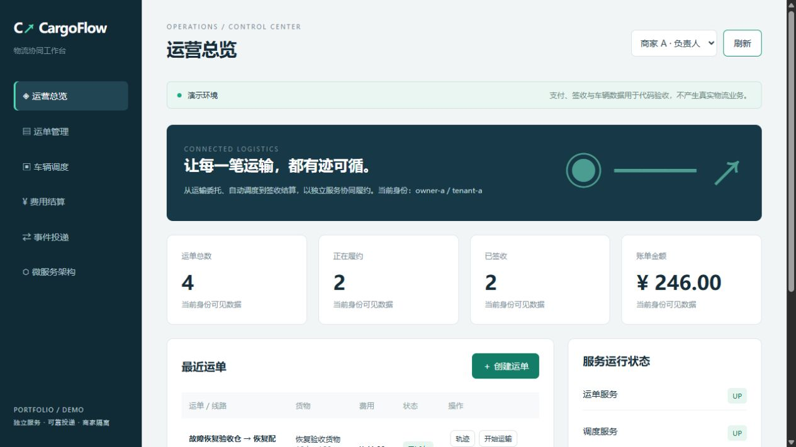
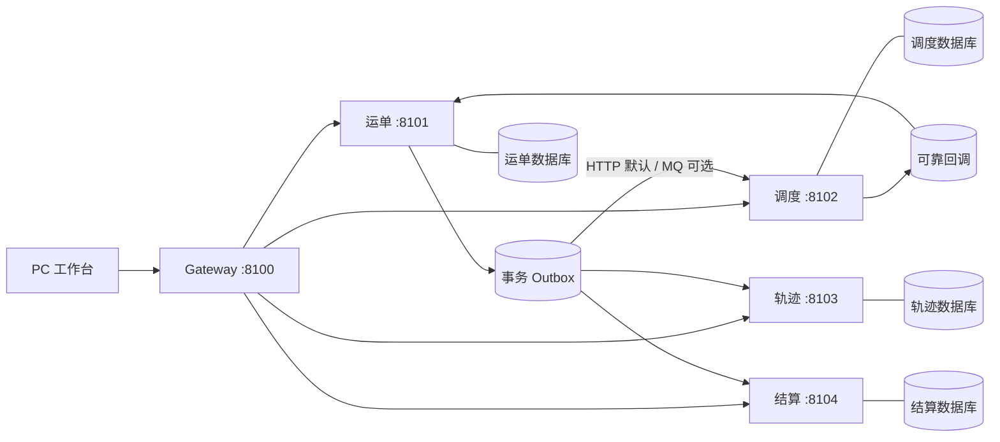

# CargoFlow · 物流协同微服务平台

[简体中文](README.md) | [English](README.en.md)

面向物流公司的 Java 微服务作品：把运输委托、车辆运力、履约轨迹和签收结算串成可运行的业务流程。提供客户、调度员、财务和负责人演示身份，以及 PC 运营工作台。



> 当前版本是商业场景的工程演示。支付为模拟；签收为姓名确认；车辆为演示数据。真实资金、GPS、司机认证、电子回单与生产运维尚未接入。

## 可以演示什么

- 创建运单并计算演示运费，相同请求标识重复提交返回同一运单。
- 自动寻找剩余载重足够的车辆；无运力时保留待调度任务。
- 已派车 → 运输中 → 已送达 → 已签收；运输开始前允许取消。
- 签收后异步生成唯一账单；重复模拟支付只保留一次收款记录。
- 签收或取消后释放车辆载重；取消先于调度时通过释放标记与补偿处理竞态。
- 按业务版本展示轨迹，重复事件去重，允许事件乱序抵达。
- 商家与客户数据隔离、角色权限、接口签名、时间窗及 nonce 防重放。
- 工作台显示业务服务状态、事件投递次数、Trace ID 与失败重试入口。

## 微服务技术与实际用途

| 技术                                    | 在项目中做什么                                   | 验证范围                                     |
| --------------------------------------- | ------------------------------------------------ | -------------------------------------------- |
| Java 17 / Spring Boot 4.0.8             | 五个独立应用、分别启动                           | 本地编译与运行通过                           |
| Spring Cloud 2025.1.3 Gateway MVC       | 统一 `/api` 路由、鉴权后签名转发                 | 本地真实网关流程通过                         |
| OpenFeign / Resilience4j                | 服务调用、超时、断路器                           | HTTP 调用已验收；断路器代码已接入            |
| JDBC / 独立 H2 数据库                   | 每个业务服务管理自己的数据                       | 业务测试通过                                 |
| 事务 Outbox / 调度回调表                | 本地事务保存待投递事件，失败退避重试             | 默认 HTTP 模式验收                           |
| RabbitMQ                                | 持久化队列、发布确认、签名消息、死信队列         | 可选适配代码与部署模板，未做 Broker 集成验收 |
| Nacos / Spring Cloud Alibaba 2025.1.0.0 | 注册发现、服务实例选择、可选配置导入             | 可选接入，未做 Nacos 集群验收                |
| Redis                                   | 授权后读取轨迹缓存，版本与事件数参与键，故障回源 | 可选接入，未做 Redis 集成验收                |
| Docker Compose / GitHub Actions         | 部署模板、自动业务测试                           | Compose 未运行验收；CI 以实际运行结果为准    |

采用最终一致性，不宣称全局 ACID、Exactly-once 或 Seata 分布式事务。默认无需中间件即可演示业务；切换 MQ 模式后发布确认仅代表 Broker 接收，消费失败还需死信处理。

## 服务拆分



## 本地启动

需要 JDK 17+、Maven 3.9+、PowerShell。五个应用初次启动可能需要约 30 秒。

```powershell
$env:JAVA_HOME='你的 JDK 17 目录'
mvn verify
./ops/start.ps1 -JavaHome $env:JAVA_HOME
./ops/smoke.ps1
```

打开 **http://127.0.0.1:8100**。页面右上角可切换五种演示身份。演示登录无需密码，默认仅绑定本机地址，请勿直接暴露到公网。

启动脚本生成本地共享随机密钥，保存在被 Git 忽略的 `.local/cluster-secret`。服务数据库和日志同样不进入仓库。停止：`./ops/stop.ps1`。修改后先停止再构建，避免 Windows JAR 文件锁。

若当前 Windows 的 Java 报 `Unable to establish loopback connection / UnixDomainSockets`，可在启动前设置 `JAVA_TOOL_OPTIONS` 的 `jdk.net.unixdomain.tmpdir` 为本项目 `.local` 下一个**不存在的目录**，使本地管道回退到 TCP；正常机器无需设置。详见 [运行与集成说明](docs/operations.md)。

## 验收和接入

- [验收记录](docs/validation.md)：业务测试与真实五进程流程。
- [运行与集成说明](docs/operations.md)：Nacos、MQ、Redis、Docker、失败恢复与生产差距。
- [业务与 API 说明](docs/business.md)：状态、权限、计价与接口。

版本选择参考 [Spring Cloud](https://spring.io/projects/spring-cloud/)、[Spring Cloud Alibaba](https://github.com/alibaba/spring-cloud-alibaba) 与 [Gateway MVC Java Routes](https://docs.spring.io/spring-cloud-gateway/reference/spring-cloud-gateway-server-webmvc/java-routes-api.html)。

## 作者

[wang2000222](https://github.com/wang2000222) · Java 后端开发，3 年经验。可承接业务系统、网页、小程序后端及接口开发。此仓库用于展示服务拆分、业务建模与可靠协同能力。
